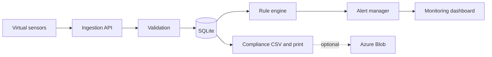
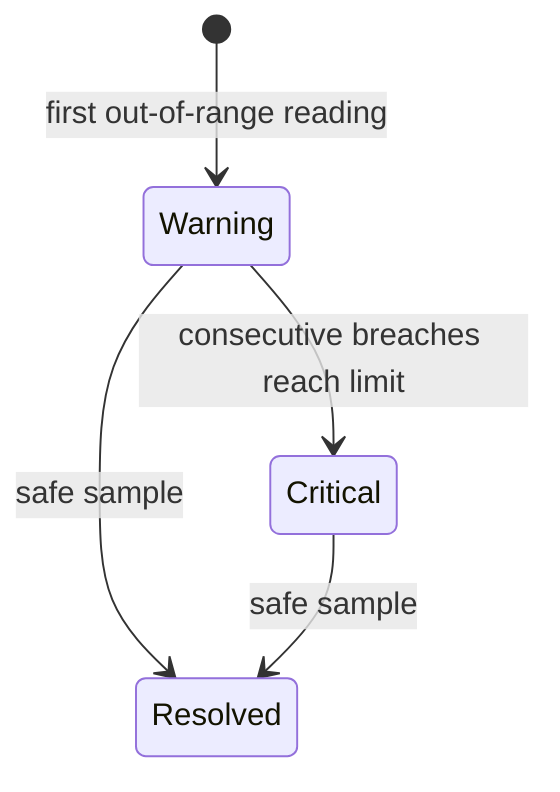

# TempTrace

TempTrace is a local academic demo for cold-chain operators. A shipment may arrive on time even after its temperature has exceeded its limits. TempTrace records simulated sensor readings, opens exceptions as conditions change, and lets operators and auditors review the evidence.

## Start

Install Node.js 24 or newer. There are no packages to install.

```sh
node server.mjs
```

Open **http://127.0.0.1:4173**. The SQLite file is created in `data/` and contains nine fictional shipments, including seven in transit. Run `node --test` to verify the API, or `npm run build` for syntax checks if npm is installed.

## Two-minute demo

1. Open **Overview** and compare active shipments, sensor health and the reading compliance percentage.
2. Inspect a vaccine shipment to see its chart, temperature band, route and audit history.
3. Open **Use case lab → Temperature excursion**. Watch the warning escalate as out-of-range samples arrive.
4. Acknowledge the alert in **Alerts**. Send **Cooling recovery** in **Live monitoring** and return to the alert history to see the resolution.
5. Download the CSV in **Compliance**, or print the shipment detail. End by tracing a reading on **Architecture**.
6. For another run, **Compliance → Reset demo data** replaces local demo records.

Other lab cases exercise stable vaccine temperatures, gradual produce warming, simulated sensor disconnect, and recovery with acknowledgment. Logistics operators monitor routes; quality staff investigate excursions; administrators set thresholds; auditors review the retained evidence. These are demo roles, without authentication.

## Azure option

Local SQLite is always used for operational data. Azure is optional and archives a copy of the report on demand.

1. Create a private Blob Storage container. Generate a short-lived container SAS token with **Create** or **Write** access, as described in [Microsoft's Put Blob documentation](https://learn.microsoft.com/en-us/rest/api/storageservices/put-blob).
2. Open **Azure settings**. Enter the container URL (without the query string) and paste the SAS token into its masked field. Save, then select **Upload compliance CSV**.
3. To supply credentials at startup, copy `.env.example` to `.env`, fill in the values locally, and run `node --env-file=.env server.mjs`. The UI can clear credentials from the running process; environment defaults return on restart.

UI credentials are kept only in server memory. Do not commit tokens or runtime data. The upload request is covered by a mocked Azure integration test; a real upload requires your container and token.

## Architecture

Node HTTP serves a responsive HTML/CSS/JavaScript application and a JSON API. SQLite handles persistence without a separate service.





Each shipment has one sensor, many temperature readings, many alerts, and many audit events. A reading, sensor state and alert updates share one database transaction. An offline event is independent of excursion severity. Operators can acknowledge alerts; recovery resolves them while preserving history. Timestamps are stored in UTC; the browser displays local time.

| Method | Route | Purpose |
| --- | --- | --- |
| GET | `/api/state`, `/api/shipments/:id` | Dashboard and shipment evidence |
| POST | `/api/shipments`, `/api/shipments/:id` | Create, update policy or advance lifecycle |
| POST | `/api/shipments/:id/telemetry`, `/api/shipments/:id/sensor` | Record Celsius reading or connectivity |
| POST | `/api/alerts/:id` | Acknowledge or resolve after recovery |
| GET | `/api/report.csv` | Download the current report |
| GET / POST | `/api/azure` | Read configuration status or set/clear credentials |
| POST | `/api/azure/export`, `/api/reset` | Archive CSV or restore seeds |

Shipments move **Scheduled → In transit → Delivered**. Reports recompute the share of readings within the currently configured thresholds; this is not a measure of elapsed time in range. Route progress estimates elapsed travel time from the planned timestamps.

## Limitations

This is a single-user loopback demo with no production authentication or hardware. Disconnection is triggered by the simulator rather than a heartbeat timeout. Alerts are in-app. Reports are demonstration records, not regulatory certification. Production development would add authentication, policy versioning, heartbeat expiry, device enrollment, notification delivery, managed database backups and role-based access.
